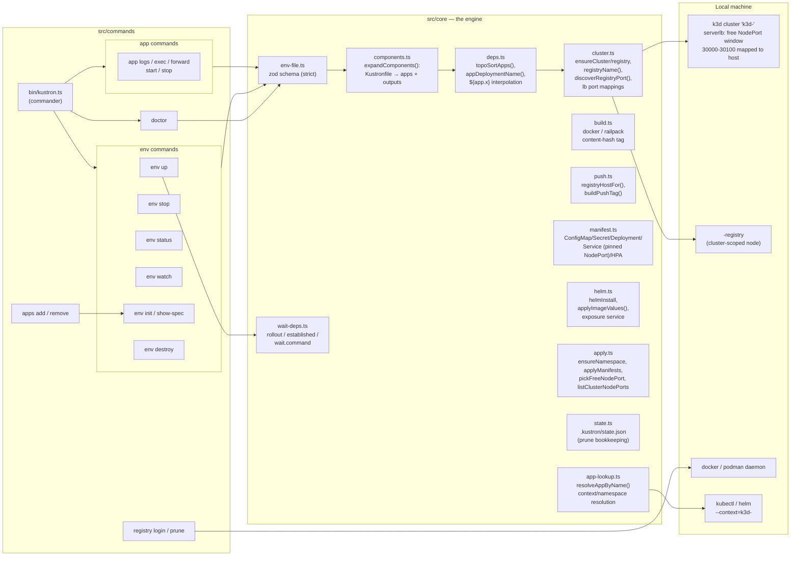

# Kustron design diagrams

Module-level architecture for kustron v2.1.x, drawn from the code as of
`master` after the registry/NodePort/imageValues/component-lifecycle fixes
(v2.1.1). Paths are `src/...` unless noted. GitHub renders the mermaid
blocks below directly — same diagrams are referenced from the README.

## 1. System overview

One CLI, three layers: a command surface (lifecycle + app commands), a
core engine (validate → expand → sort → prepare cluster → build → push →
deploy → wait), and the external tools kustron drives (k3d, container
runtime, kubectl/helm) — always pinned to `--context=k3d-<clusterName>`.



Notes:

- Every kubectl/helm call is issued with the `k3d-<clusterName>` context,
  so the user's current kubectl context is never switched
  (`src/core/kubectl.ts`).
- Cluster, registry, and NodePort concerns all live in `cluster.ts` +
  `apply.ts`; registry hosts are cluster-scoped so parallel clusters don't
  collide (`registryName()` in `src/core/cluster.ts`).

## 2. The `env up` reconcile loop

`env up` is designed to be idempotent — running it with no changes is a
fast no-op. The reconcile path is what makes it deterministic:

```mermaid
sequenceDiagram
  autonumber
  participant U as User
  participant CLI as env up (src/commands/env/up.ts)
  participant C as core
  participant K as k3d / container runtime
  participant KC as kubectl / helm (--context=k3d-<cluster>)

  U->>CLI: kustron env up
  CLI->>C: read + zod-validate kustron-env.yaml (strict)
  CLI->>C: expandComponents() → apps, outputs
  CLI->>C: topoSortApps() (cycle-checked)
  CLI->>K: clusterExists? → start existing / create with free-port lb mappings
  CLI->>K: ensureRegistry(clusterName) — cluster-scoped
  CLI->>C: discoverRegistryPort() (docker inspect; fallback: probe)
  CLI->>KC: ensure metrics-server, namespaces

  loop each app, dependency order
    CLI->>KC: wait on dependsOn (rollout / established / wait.command)
    CLI->>CLI: hooks.pre (host shell)
    alt source app, image already deployed (same content hash)
      CLI->>CLI: skip build+push
    else source app
      CLI->>K: build (docker or railpack) → tag <registry>/<app>:<sha>
      CLI->>K: push localhost:<registryPort> (--tls-verify=false on podman)
    end
    alt helm app
      CLI->>KC: helm upgrade --install (+ inject image via applyImageValues)
    else builtin template
      CLI->>C: buildService pins cluster-free NodePort when exposed
      CLI->>KC: apply ConfigMap/Secret/Deployment/Service/HPA
    end
    CLI->>KC: rollout wait — fail fast on ImagePull/CrashLoopBackOff, warn after 150s
    CLI->>CLI: hooks.post
  end

  CLI->>C: prune apps removed from yaml (state.json)
  CLI->>KC: prune old ReplicaSets
  CLI->>U: summary (exposed URLs: localhost:<nodePort>)
```

Same-file idempotency (verified live in the k3d test cluster): unchanged
source keeps the same content hash, so step 8's skip fires and only the
K8s reconcile happens; env-var/replica changes apply without a rebuild;
apps deleted from the yaml are deleted from the cluster at step 16.

## 3. Watch loop

`env watch` (src/commands/env/watch.ts) is a loop around `env up`: it
watches local `source:` directories with chokidar, debounces bursts
(500 ms), and re-runs the full reconcile on each trigger. The content
hash is what makes each iteration cheap: only the apps whose source
actually changed get a build + rollout.

```mermaid
flowchart TB
  A[chokidar watches source: dirs<br/>(non-git), dotfiles ignored] -->|change event| B[debounce 500ms]
  B --> C[env up reconcile]
  C -->|source changed for app X| D[rebuild + push + re-roll app X only]
  C -->|yaml-only change| E[apply manifests / helm upgrade, no rebuild]
  C -->|nothing changed| F[fast no-op, hashes match]
  D & E & F --> A
```

Limitation worth knowing (and the main gap vs tilt.dev — see
`docs/comparison.md`): the loop redeploys via image rebuild + rollout
rather than in-place file sync, and non-source apps (helm/image) are not
watched.
